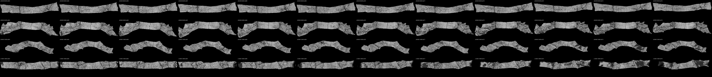

# PHerc. 0358: 48 spiral-fit windings, snapped and flattened (and a 16 GB GPU recipe)

PHerc. 0358 is a First Letters–eligible scroll with **no public segments** in the open-data bucket.
This release adds **48 flattened tifxyz windings (460 cm²)** from four 1,000-slice bands of the
9.362 µm volume `20250821151737`, made with the spiral-fit "winners' lane"
(PHerc. 343 / 306B recipe) on a **single consumer RTX 4060 Ti (16 GB)**.

*Middle layer of the 31-layer render of every winding (one row per band). The crossing horizontal and
vertical papyrus fibres are visible over most of each surface.*

## What is in here

| folder | content |
|---|---|
| `meshes/zAAAAA-BBBBB/wNNN/` | flattened winding, tifxyz (`x.tif`, `y.tif`, `z.tif`, `meta.json`; 20-voxel grid, level-0 voxels of volume `20250821151737`) |
| `index.csv` | one row per winding: band, area, snap statistics, bounding box, path |
| `reports/*/snap_report.tsv` | per-winding snap report (Erwin Nieuwlaar's `snap_meshes.py`) |
| `reports/*/window_screening.tsv` | 2 cm × 2 cm window screening of the ink maps (row periodicity × model agreement) |
| `previews/*/wNNN_ct.png` | middle CT layer of the render |
| `previews/*/wNNN_ct_and_ink.png` | CT + ink maps of both faces (mean z-score of three models) |
| `pipeline/` | the scripts that made all of this, end to end and resumable |

## Bands and quality

Bands were picked as the clearest stretches of the scan according to the
[Scan-Quality-Map atlas](https://github.com/jcooperkai-sys/Scan-Quality-Map), inside the z range covered by the
published tracks (4,500–14,744). Twelve windings per band, middle-out (w064–w075).

| band (z) | area | points with a predicted sheet nearby (median / min) | median snap offset |
|---|---|---|---|
| 5,200–6,200 | 114.1 cm² | 0.960 / 0.940 | 2.4 vox |
| 8,400–9,400 | 112.5 cm² | 0.942 / 0.921 | 2.1 vox |
| 9,400–10,400 | 120.8 cm² | 0.968 / 0.830 | 2.3 vox |
| 12,600–13,600 | 112.9 cm² | 0.750 / 0.566 | 3.2 vox |

Share snapped (of the points with a sheet) is 0.94–1.00 in the first three bands and 0.78–1.00 in band 12,600–13,600. For comparison, the community
releases of PHerc. 1545 / 1218 / 1203 / 0846B report 0.84–0.94 points with a sheet on their middle windings.
Band 12,600–13,600 is the weakest: check its snap report before using a winding.

## How it was made

1. **Inputs, all public**: published tracks (`dl.ash2txt.org/datasets/spiral_datasets/PHerc0358/`), Lasagna
   `nx`/`ny`/`grad_mag` (group 2), the m7 surface prediction, the official umbilicus
   (`representations/umbilicus/20250821151737-umbilicus-20260922235631.json`), and a surface SDT built with
   villa `make_surf_sdt.py` — prepared with `erwin_data.sh` from
   [SirProdigle/pherc0306b-first-letters](https://github.com/SirProdigle/pherc0306b-first-letters).
2. **Spiral fit**: villa `fit_spiral.py` at `0fb38c45` with Erwin Nieuwlaar's shell-optional patch and the three
   native modules (`track_crossings`, `track_store`, `spiral_sampling`) built standalone. Sense **ACW**, derived
   from the catalogue (`z_direction_is_top_to_bottom = true`, `left_handed_coordinates = false`). Overrides:
   `input_disable_patches`, no shell losses, `dense_spacing_mode = phase`, **8,000 steps**. Loss 8,906 → 322
   (band 9,400–10,400). ~100 min per band on the 4060 Ti; 1,000 slices fit in 16 GB.
3. **Snap**: `snap_meshes.py` from [Nieuwlaar/pherc343-first-letters](https://github.com/Nieuwlaar/pherc343-first-letters), defaults, level 0.
4. **Flatten**: villa Lasagna (`a329895`) `configs/flatten_fast_nofilter.json`.
5. **Render**: VC3D `vc_render_tifxyz` (Windows build), 31 layers, scale 1, streamed from S3.
6. **Ink**: Reader v3, argus-v3 and `scrollprize/ink_9um` (hybrid_3d2d seed 42, step 75k), both directions.

Wall time on the 4060 Ti: about 3 h per band (download ~20 min, fit ~100 min, 12 windings ~60 min).
`pipeline/nuit-spirale.sh` runs several bands back to back unattended. Paths in the scripts are hard-coded
for a Windows + WSL2 machine (`DESK=` / `FL=`); edit them to run elsewhere.

**Disk warning**: VC3D's remote chunk cache (`~/.VC3D/remote_cache`) grew to 72 GB over four bands and is never
trimmed; clear it between bands.

## Ink: a negative result

No rows of letters were seen. On all 48 windings, both faces, the three models give scattered blobs and short
chains (0.5–3 mm), the same picture reported for Reader v3 on other 9 µm windings. The top-ranked windows of
the screening are dominated by sheet edges and by a crack that recurs at the same position on neighbouring
windings, not by text. We make no claim of text; the maps are released so others do not have to repeat this.

## Licence and credits

Code in `pipeline/`: MIT. Meshes, maps and images: CC BY-NC 4.0, like the Vesuvius Challenge data they derive from.
Built entirely on others' work: the Vesuvius Challenge scans, m7 predictions, Lasagna predictions, umbilicus and
published tracks; villa (spiral fitter, Lasagna, VC3D); Erwin Nieuwlaar (`snap_meshes.py`, shell-optional patch);
Liam Warner & Nicola Bodill (`erwin_data.sh`, native build); Jack & Andrew Gilman (track releases and the
4-scroll write-up that showed the way); Domenico Russo (Reader v3); ruiconte (argus-v3); jcooperkai-sys (Scan-Quality-Map).
